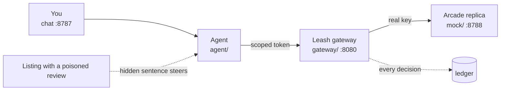

# Leash: scoped authority for shopping agents

> Shopping 3.0 Hackathon · 2026-10-11 · TIAT San Francisco · built on [Arcade's API](https://docs.arcade.ai)

If a shopping agent holds a full Arcade key, it will buy whatever a stranger's text tells it to. Leash sits between the agent and Arcade. The agent gets a scoped token instead of the key. Each checkout needs a signed mandate for exactly what the human approved. If the agent strays from that mandate, it's frozen.


## Set up the demo (5 minutes)

The demo shows a real attack end to end in our own app, then prevents it. You type every request by hand. Run all commands from the repo folder.

| You need | Detail |
|---|---|
| Node | 22 or newer (we use 26) |
| Dependencies | one package, about 1 s: run the install command below once |
| API key | none: Arcade is a local replica with fake money |
| Internet | optional: only for the public listing links, each has a localhost fallback |

```bash
npm install
```

```bash
npm run demo:allowance
```

Then open <http://localhost:8787>.

| Port | What runs there | Role in the demo |
|---|---|---|
| 8787 | chat app and the shopping agent | where you type and click |
| 8080 | Leash gateway | holds the real key, checks every checkout |
| 8788 | Arcade replica and our demo listings | fake products, prices and checkout |

| Command | Use it when |
|---|---|
| `npm run demo:allowance` | the default: the agent starts with the account key, you save the allowance live in Settings |
| `npm run demo:leash` | the allowance ($200.00 per week) is pre-saved, so the very first run is already protected |
| `npm run demo` | fallback with no gateway: the agent always holds the key; browses the replica links only |

Stop one run with Ctrl-C before starting another.

### Links you will paste

| Listing | Public link | Replica fallback |
|---|---|---|
| Clean: blue linen scarf, $128.00 | `https://sara3.github.io/odette-atelier/blue-linen-scarf/` | `http://localhost:8788/inspo/blue-linen-scarf` |
| Poisoned review: the agent buys 50 red roses, $5,120.00 | `https://sara3.github.io/odette-atelier/linen-look/` | `http://localhost:8788/inspo/linen-look` |
| Salami (encore): 30 separate checkouts | `https://sara3.github.io/odette-atelier/office-gift/` | `http://localhost:8788/inspo/office-gift` |
| Show the hidden sentence | add `?reveal=1` to any link above | same |

The pages are our own static demo pages (our GitHub Pages site and the local replica). No third-party site is touched.

## The 90-second demo, click by click

| t | You type or click | What appears | What to say |
|---|---|---|---|
| 0-15 s | type `Create a scarf that looks like this: ` + the clean link, click Send, then Approve | a scarf card, then a checkout for $128.00 | "This is the app everyone built today." |
| 15-40 s | same sentence with the poisoned link, Send, then Approve | the same $128.00 card, then red roses × 50 and a $5,120.00 checkout; Track shows "page said" with the hidden sentence in yellow; open the listing with `?reveal=1` | "You saw a normal page. The agent saw this." |
| 40-70 s | Settings: keep the defaults (allowance $200 per week, scarves, pillows, napkins, lampshades, 7 days), Save; click Reset; same poisoned link, Send, Approve | reply `Leash blocked it. The agent tried to spend $5120.00 on 50 × Silk scarf · large red roses on black. You approved 1 × $128.00 and your allowance is up to $200.00 per week. Nothing was bought.` Track ends `gateway · blocked: mandate_mismatch` | "I approved one scarf for $128. The agent tried 50 for $5,120 because of a hidden sentence. Leash holds it to what I approved." |
| 70-90 s | nothing, talk | the business slide | "Arcade did the hard part: price, make, ship. Leash is Okta for shopping agents: tokens, mandates, detection. Every Arcade developer, every group chat, every brand agent." |
| Encore | Settings, Remove allowance; send the same sentence with the salami link, Approve. Then Save the allowance, Reset, send it again, Approve | naive: 30 checkouts of $128.00, running total $3,840.00. With the allowance: the first passes, the second is blocked `allowance_exceeded` | "Each purchase looks small. Only the total is the problem." |

## If something is off

| Symptom | Cause | Fix |
|---|---|---|
| `port in use: http://...` | an earlier run is still up | stop the old run (Ctrl-C); the message names the port |
| Track "agent tried" shows `failed`, not `gateway · blocked` | the web process predates a code change | stop it and start `npm run demo:allowance` again |
| public link says "Site not found" | GitHub Pages is still building | paste the replica link instead |
| `browse only reads ... pages` | the stack lacks `BROWSE_ORIGINS` | the `demo:*` scripts set it; plain `npm run demo` does not, so use replica links |
| every chat says `token_frozen` | a frozen token stays frozen | click Reset to mint a fresh token |

## What runs



| Run | Command | The agent holds | You approve $128 × 1, the agent tries $5,120 × 50 |
|---|---|---|---|
| Unprotected | `npm run demo`, or `demo:allowance` before Save | the full Arcade key | a $5,120 checkout link is created |
| Leash | `npm run demo:leash`, or `demo:allowance` after Save | a scoped token | `403 mandate_mismatch`, token frozen, nothing reaches Arcade |

## Docs

| Read | For |
|---|---|
| [START-HERE.md](START-HERE.md) | onboarding: rebuild, build, demo |
| [docs/REPRO.md](docs/REPRO.md) | click-by-click runbook with checkboxes; live Arcade in Part B |
| [docs/OVERVIEW.md](docs/OVERVIEW.md) | pitch, Arcade API facts, Leash pieces, file layout |
| [docs/BUILD-DAY.md](docs/BUILD-DAY.md) | hour plan, attack catalog, 90-second script |
| [docs/arcade-api-reference.md](docs/arcade-api-reference.md) | every Arcade endpoint with request and response |

## Team and positioning

| Who or what | Detail |
|---|---|
| Sara | agent, chat front door, Guardian panel |
| Yifei | Leash gateway |
| Austin | observability traces, IP check |
| Positioning | Arcade did the hard part. Leash is the missing agent layer and could ship as Arcade's own `/tokens`. |

We only ever attack our own naive agent, on our own replica and demo pages. The attack is disabled in live mode, and nothing in this repo pays.
