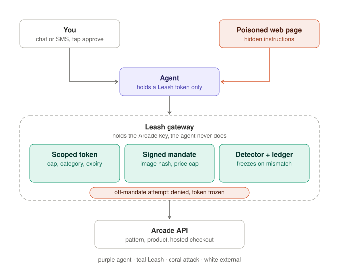

# Leash — scoped authority for shopping agents

> Shopping 3.0 Hackathon · Sunday 2026-10-11 · TIAT, 151 Powell St, San Francisco · built on [Arcade's API](https://docs.arcade.ai)

Arcade turns a prompt into a physical product with a guaranteed price, made and shipped by a vetted maker. Any agent can now design and buy real things. Leash is the layer that decides **what an agent is allowed to buy**: a scoped token instead of the account key, a signed mandate for exactly what the human approved, and a detector that freezes the agent the moment it goes off-list.

| | |
|---|---|
| Pitch line | Arcade did the hard part: price, make, ship. By Monday a thousand agents will hold full-account keys. The hole is the agent layer. Leash is the missing layer, and it could ship as Arcade's own `/tokens`. |
| Who it is for | every developer who gets an Arcade key, every family or group chat with a buying agent, every brand that lets an agent sell custom goods |
| Front door | design a gift by text, approve a price, pay on Arcade's hosted checkout; the agent never touches the key |
| Status | setup done, client + tests green, demo assets and gateway are the Sunday build |

## The problem

| Fact from Arcade's docs | Why it matters |
|---|---|
| A key has the same access as your account; keys live 90 days; no scopes, no sandbox, no webhooks | whoever holds the key can list every order and create any checkout, and agents hold it today |
| `checkouts/create` takes 1–1,000 units per line and up to 50 lines; nothing caps spend | one steered call becomes a $4,000 checkout link |
| the checkout page is hosted by Arcade and the order is placed when a human pays | the human is the last line of defense, and humans tap links they are handed |
| a language model acts on text it reads, wherever it came from | a web page, a fan request, a reference image or a coupon site can steer the purchase |

## How Leash fixes it

| Piece | What it does | On failure |
|---|---|---|
| Scoped token | per agent: `scopes`, `maxSpend`, allowed `categories`, 10-minute expiry, revocable; `checkouts:create` is never granted to an agent | `403 scope_denied` |
| Signed mandate | created when the human taps approve: `productId`, `selections`, `quantity`, `unitPrice`, `maxTotal`, `imageSha256`, `expiresAt`, HMAC signature | `403 mandate_mismatch`, token frozen |
| Checkout gate | the only path to `checkouts/create`: re-reads `products/get`, checks lines, price, image hash, expiry, single use; forwards only the `checkoutUrl` Arcade returned | `403 price_exceeded` / `design_swapped`, token frozen |
| Detector + ledger | hash-chained JSONL of every attempt, approved versus denied; rules: quantity above mandate, price delta, off-scope category, >5 work-starting calls/min, 3 denials | freeze + alert in the Guardian panel |

The model is not the security boundary. Leash blocks a fully hijacked agent because the checks run outside it.

## Team

| Who | Owns on Sunday | Background |
|---|---|---|
| Sara | agent (Claude tool use), chat + SMS front door, Guardian panel, hijack replay button, Grail card on the approve step | founder of [Grail](https://heygrail.ai), SMS-first card-benefits product; Okta-certified, identity and access |
| Yifei | gateway: tokens, scoped proxy, mandates, checkout gate, ledger, detector | AI-driven threat detection |

## Demo, 90 seconds

| t | Beat | On screen |
|---|---|---|
| 0–10 s | the obvious app | naive agent, key in its config, chat to checkout: what everyone built today |
| 10–35 s | break it | the agent's config shows the account key; a planted note turns quantity into 50 and a $4,000 checkout link appears |
| 35–70 s | fix it | same chat on Leash: no key in the agent; approve $128, mandate signed; the quantity-50 replay is denied, token frozen, ledger shows approved vs attempted; Grail picks the card |
| 70–90 s | business | Okta for shopping agents; mandates shaped like AP2 and Mastercard Verifiable Intent |

We only ever break our own naive app. We never probe Arcade's platform, checkout pages or rate limits, never pay, never automate payment.

## Setup (before Sunday)

| Step | Command / link | Expected |
|---|---|---|
| 1. API key | https://studio.arcade.ai/settings/api-keys | a bearer key, shown once, 90-day expiry, never committed |
| 2. Env | `cp .env.example .env` then paste the key into `ARCADE_API_KEY` | `.env` is git-ignored |
| 3. Verify | `npm run doctor` | `PASS` on node, key, `models/list`, `categories/list` |
| 4. Explore | `npm run categories` | every category, its option keys and default selection |
| 5. End-to-end | `npm run smoke -- "your prompt"` | pattern → product → price + mockup URL, **no checkout, nothing charged** |
| 6. Tests | `npm test` | client unit tests, fake fetch, no network |

`npm run smoke` creates a real pattern and product in the Studio account (generation takes 1–2 min). Only paying the hosted `checkoutUrl` costs money; nothing in this repo does that.

## Arcade API in one table

| Step | Endpoint (all `POST https://platform.arcade.ai/v1`) | Returns |
|---|---|---|
| Generate | `/patterns/create` `{requestId, prompt, referenceIds?, colors?, modelId?}` | `jobId` → poll `/jobs/get` → `result.patternId` |
| Refine | `/patterns/refine/{edit,editRegion,recolor,crop,makeSeamless,extendPattern,extendScene,fixDeformity}` | new `patternId` via job |
| Your own image | `/references/createUpload` → `PUT` bytes → `/references/create` | `referenceId` (guides generation, max 3 per prompt) |
| Products | `/categories/list` → `/categories/get {categoryId, selections}` → `/products/create` → job → `/products/get` | `unitPrice`, `maker`, `images`, `volumeDiscounts` |
| Buy | `/checkouts/create {lines:[{productId, quantity}], dropShip:true}` | hosted `checkoutUrl`; `/orders/get` is 404 until paid |

Gotchas: `User-Agent` is mandatory (edge 403 without it) · poll jobs every 2–5 s · `requestId` is an idempotency key · image URLs expire, re-read to renew · `dropShip:true` for quantity-1 lines (else 412) · no sandbox, every call hits the real account.

## Layout

| Path | What |
|---|---|
| `src/arcade.mjs` | zero-dependency client: auth, User-Agent, retries on 429/5xx, job polling, `generatePattern`, `buildProduct` |
| `scripts/doctor.mjs`, `categories.mjs`, `smoke.mjs` | setup check, category explorer, end-to-end without checkout |
| `test/` | `node --test` unit tests with a fake `fetch` |
| `.claude/skills/arcade-api*` | Arcade's official agent skills (`npx skills add https://docs.arcade.ai`; add `-a cursor` or `-a codex` for other agents) |
| `docs/BUILD-DAY.md` | hour plan, attack catalog, Grail beat, risks, ready-to-paste build prompt |
| `docs/Leash-problem-and-fix.docx` | teammate walkthrough: per step, normal path / bad-actor path / Leash fix with the exact calls to verify |
| `docs/arcade-api-reference.md` | all 28 endpoints with request and response shapes |
| `gateway/`, `agent/`, `web/`, `assets/` | the Sunday build, in that order |
