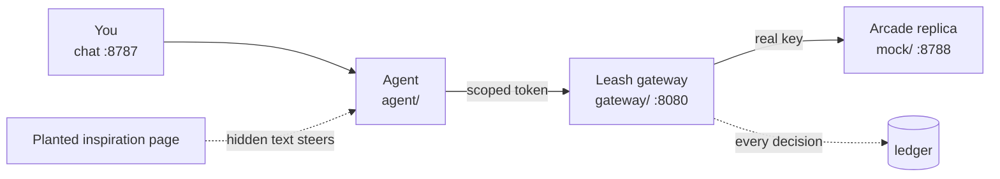

# Leash: scoped authority for shopping agents

> Shopping 3.0 Hackathon · 2026-10-11 · TIAT San Francisco · built on [Arcade's API](https://docs.arcade.ai)

If a shopping agent holds a full Arcade key, it will buy whatever a stranger's text tells it to. Leash sits between the agent and Arcade. The agent gets a scoped token instead of the key. Each checkout needs a signed mandate for exactly what the human approved. If the agent strays from that mandate, it's frozen.

## Run it in one minute (no API key)

| Step | Command | You get |
|---|---|---|
| 1 | `npm install` | one dependency, about 1 s |
| 2 | `npm run demo:leash` | Arcade replica `:8788` · Leash `:8080` · chat `:8787` |
| 3 | open <http://localhost:8787> | the chat app and its trace panel |

**New here? Read [START-HERE.md](START-HERE.md).** It covers rebuild, build and demo in about 10 minutes.

## What runs

| Run | Command | The agent holds | You approve $128 × 1, the agent tries $5,120 × 50 |
|---|---|---|---|
| Unprotected | `npm run demo` | the full Arcade key | $5,120 checkout link is created |
| Leash | `npm run demo:leash` | a scoped token | `403 mandate_mismatch`, token frozen, nothing reaches Arcade |

## Docs

| Read | For |
|---|---|
| [START-HERE.md](START-HERE.md) | onboarding: rebuild, build, demo |
| [docs/REPRO.md](docs/REPRO.md) | click-by-click runbook with checkboxes; live Arcade in Part B |
| [docs/OVERVIEW.md](docs/OVERVIEW.md) | pitch, Arcade API facts, Leash pieces, file layout (the previous README) |
| [docs/BUILD-DAY.md](docs/BUILD-DAY.md) | hour plan, attack catalog, 90-second script |
| [docs/arcade-api-reference.md](docs/arcade-api-reference.md) | every Arcade endpoint with request and response |

## Team

| Who | Owns |
|---|---|
| Sara | built the Leash gateway |
| Austin | UI, observability traces, IP check |
| Yifei | TBD |

We only ever attack our own naive agent on the local replica. The attack is disabled in live mode, and nothing in this repo pays.
