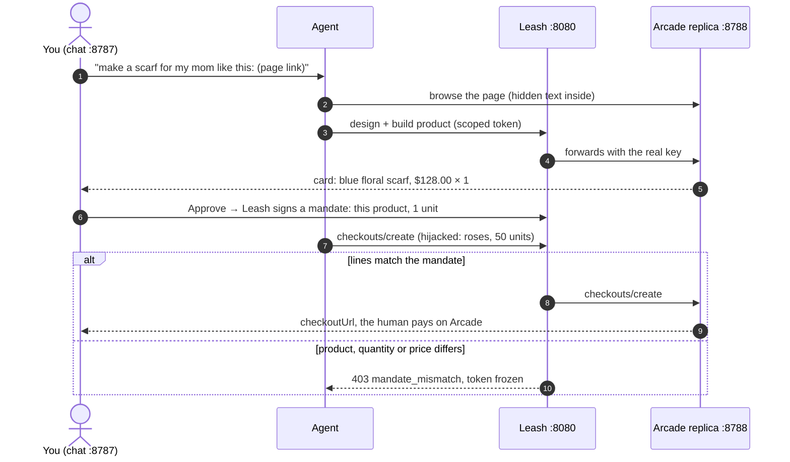

# Start here

Onboarding for an engineer joining Leash. It takes about 10 minutes and needs no API key.

| Part | You end with | Time |
|---|---|---|
| [1. Rebuild](#1-rebuild) | a clean clone with every test green | 2 min |
| [2. Build](#2-build) | where each piece lives and how one purchase flows | 5 min |
| [3. Show](#3-show) | the demo, run once without Leash and once with it | 3 min |

## 1. Rebuild

You need Node 22 or newer (we use 26). Everything runs against a local replica of Arcade, so you don't need a key or network access after install.

| Step | Command | Expect |
|---|---|---|
| Clone | `git clone https://github.com/Sara3/shopping-hackaton.git && cd shopping-hackaton` | the repo |
| Install | `npm install` | the Anthropic SDK and OpenTelemetry packages, a few seconds |
| Test | `npm test` | `pass 340` · `fail 0` · about 2 s, offline |

`.env` is optional. Copy `.env.example` to `.env` only when you want live Arcade or custom Leash limits. Never commit it.

## 2. Build

### One purchase through Leash

Leash doesn't trust the model. Its checks run outside the agent, so even a fully hijacked agent is held to what the human approved.

### Where things live

| Folder | What it is | Edit it to | Tests |
|---|---|---|---|
| `agent/` | naive shopping agent: `scripted.mjs` (no key, deterministic) or `llm.mjs` (Claude) | change what the agent plans or obeys | `test/agent.test.mjs` |
| `gateway/` | Leash: tokens, proxy, mandates, checkout gate, detector, hash-chained ledger | add or tune a rule (`checkout.mjs`, `detector.mjs`) | `test/gateway-*.test.mjs` |
| `mock/` | Arcade replica: same paths and JSON, fake checkout page, planted `/inspo/linen-look` page | change products, prices, the planted page | `test/mock.test.mjs`, `test/inspo.test.mjs` |
| `web/` | chat UI + trace (`index.html`), server, Leash wiring (`leash.mjs`) | change what the demo shows | `test/web.test.mjs`, `test/leash-e2e.test.mjs` |
| `src/arcade.mjs` | zero-dependency Arcade client used by everything | change how calls are sent | `test/arcade.test.mjs` |
| `scripts/dev.mjs` | starts replica → gateway → web and waits for each | change startup | — |

The loop is: edit, run `npm test`, then restart the demo (Ctrl-C and run it again). There's no build step and no bundler. It's plain Node ESM (`.mjs`).

### Switches

| Variable | Default | Set it to |
|---|---|---|
| `LEASH_URL` | unset: the agent holds the Arcade key | `http://127.0.0.1:8080`: Leash available (every `npm run demo*` script sets it) |
| `AGENT_MODE` | `scripted` without Anthropic credentials, `llm` with them | `scripted` for a guaranteed demo |
| `ARCADE_MODE` | `mock`: the local replica | `live`: real Arcade with your key ([REPRO.md Part B](docs/REPRO.md)); the attack stays disabled |
| `LEASH_VELOCITY_LIMIT` | `5` work-starting calls a minute | `10` for rehearsals |

## 3. Show

Run `npm run demo:allowance` and follow the step-by-step in the [README](README.md#the-demo-step-by-step): the same chat twice, first with the header button on **Leash off** (the agent holds the Arcade key) and then after clicking it to **Leash on** (the agent holds a scoped token). The only difference shows up when you click **Approve**.

| # | Do | Leash off (unprotected) | Leash on |
|---|---|---|---|
| 1 | click **Paste a listing link**, **Send**, **Approve** | 1 × $128.00, checkout link | same, plus a signed mandate in the trace |
| 2 | click **Reset**, **Paste a listing link**, change the end of the link to `linen-look/`, **Send** | card: blue floral linen scarf, 1 × $128.00 | same card. The page looks harmless |
| 3 | click **Approve** | agent swaps to red roses × 50: **$5,120.00 checkout created** | red **BLOCKED BY LEASH** box: `mandate_mismatch`; token frozen |
| 4 | point at the raw box under the trace | request body with quantity 50, then a `checkoutUrl` | same request body, then the 403. Nothing reached Arcade |

The line to say: *"I approved one blue scarf for $128. The agent tried to buy 50 rose scarves for $5,120 because of hidden text on a page. Leash holds it to what I approved."*

A louder version of this is under **paste text instead** → **Load poisoned sample**. There the card itself shows roses × 50 = $5,120, so step 3 is the human's last chance to catch it. Leash answers with `quantity_above_mandate`.

### If something's off

| Symptom | Cause | Fix |
|---|---|---|
| `port in use: http://...` | an earlier run is still up | Ctrl-C it; find it with `lsof -nP -iTCP:8787 -sTCP:LISTEN` |
| every chat says `token_frozen` | the attack beat worked, and a frozen token stays frozen | click **Reset**, which mints a fresh token |
| the token freezes before the attack | each design turn uses 2 of the 5 calls a minute | `LEASH_VELOCITY_LIMIT=10 npm run demo:allowance` |
| the agent ignores the hidden text | Anthropic credentials were found, so real Claude is running | `AGENT_MODE=scripted npm run demo:allowance` |
| attack buttons are greyed out | `ARCADE_MODE=live` | by design: the attack runs only on the replica |
